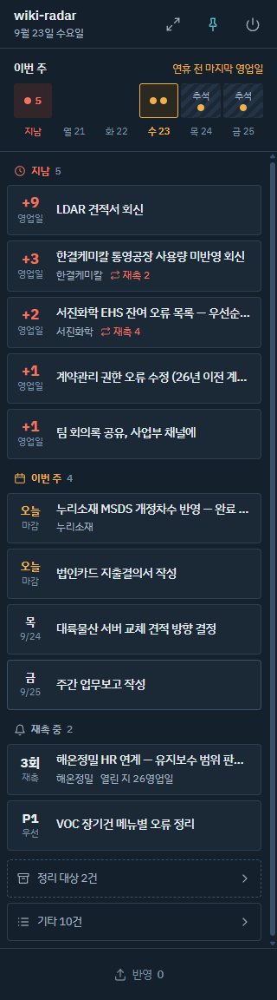
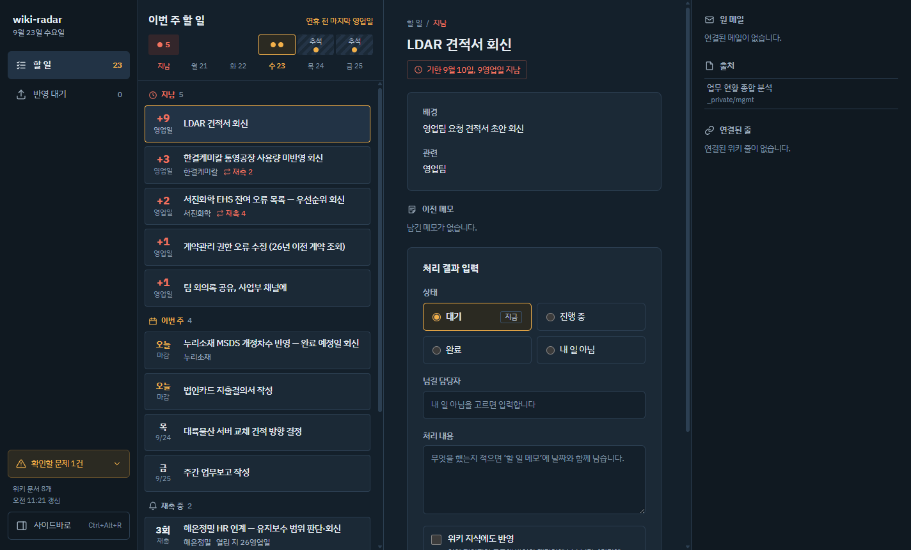
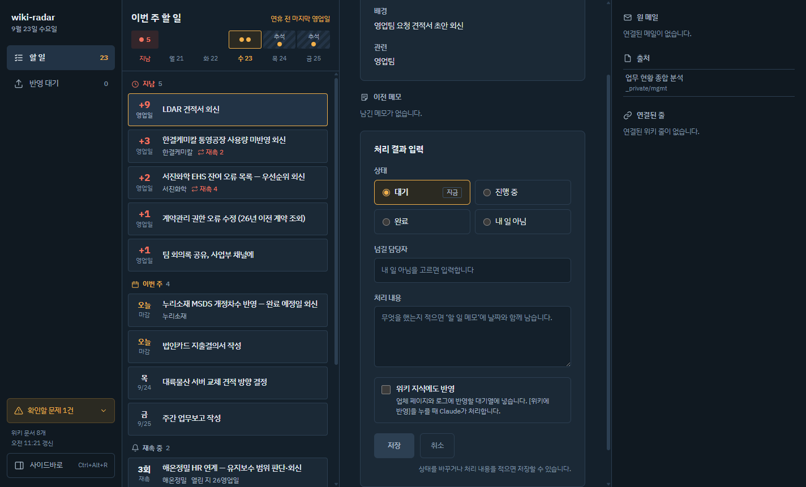
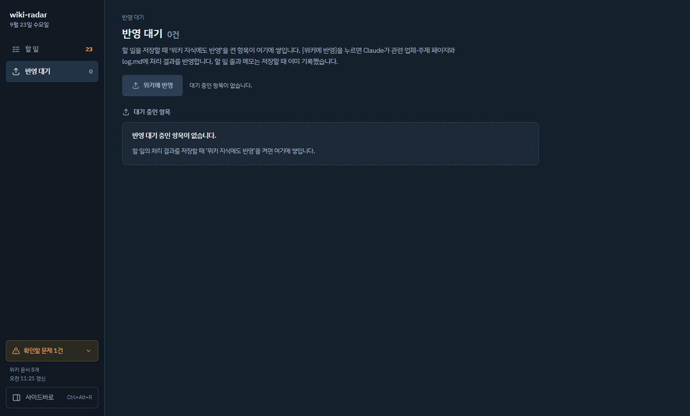

# wiki-radar

Obsidian 개인 위키에 쌓인 **할 일과 지식을 작업하는 동안 화면 옆에 띄워두고 보는** Windows 데스크톱 앱입니다.

Claude Code가 관리하는 LLM 위키(LLM이 원본을 읽고 위키 페이지를 쓰고 고치는 "LLM Wiki" 패턴)는 지식이 계속 쌓이지만, 정작 주인이 그 변화를 알아채기 어렵습니다. wiki-radar는 네 가지로 이 틈을 메웁니다.

| 문제 | 기능 | 상태 |
|---|---|---|
| 이번 주에 할 일이 안 보인다 | **이번 주 할 일** — 지남·이번 주·재촉·정리 대상으로 나눠 보여주고, 공휴일이 낀 주는 트랙에 표시 | 1단계 ✅ |
| 처리해도 위키에 안 남는다 | **처리 결과 입력 → 위키 반영** — 할 일 줄·메모를 바로 기록하고, 지식 반영은 대기열에 모아 `claude -p`로 일괄 처리 | 2단계 ✅ |
| 필요할 때 관련 지식이 안 떠오른다 | **맥락 리콜** — 활성 창 제목(Excel 파일명 등)으로 관련 위키 페이지를 띄움 | 3단계 |
| Claude가 바꾼 것을 모른다 | **변경 피드 · 판단 대기함** — 마지막 확인 이후 바뀐 페이지와 로그 속 "소유자 판단 요청" | 3단계 |

> 이 앱은 특정 위키 구조(`_private/mgmt/내 할 일.md`, `_todo-sync/items.json`, `raw/mail/…` 등)를 전제로 만든 개인 도구입니다. 다른 위키에 쓰려면 `docs/stage1-contract.md`의 할 일 모델을 먼저 보세요.

## 화면

| 사이드바 (항상 위, 320px) | 풀스크린 |
|---|---|
|  |  |

| 처리 결과 입력 | 반영 대기 |
|---|---|
|  |  |

스크린샷은 테스트용 샘플 데이터(`test/fixtures/wiki`)입니다. `Ctrl+Alt+R`로 사이드바와 풀스크린을 오갑니다.

## 실행

요구 사항: Windows 10/11, Node.js 22 이상. (Electron 44를 내려받습니다.)

```bash
npm install
npm start                 # 개발 실행
npm run package           # 빌드 → out/wiki-radar-win32-x64/wiki-radar.exe
```

설정은 환경 변수로 바꿉니다.

| 변수 | 기본값 | 뜻 |
|---|---|---|
| `WIKI_RADAR_WIKI` | `%USERPROFILE%\OneDrive\Obsidian\WIKI` | 위키(Obsidian 볼트) 경로 |
| `WIKI_RADAR_DATA` | `%APPDATA%\wiki-radar` | 반영 대기열·실행 기록 저장 폴더 |
| `WIKI_RADAR_CLAUDE` | PATH의 `claude.exe` → `%USERPROFILE%\.local\bin\claude.exe` | 지식 반영에 쓸 Claude Code |
| `WIKI_RADAR_TODAY` | 오늘 | 날짜 고정(테스트용) |

샘플 위키로 띄워 보기: `set WIKI_RADAR_WIKI=%CD%\test\fixtures\wiki` 후 `npm start` (샘플을 고치지 않으려면 복사본을 쓰세요 — 처리 결과를 저장하면 파일이 바뀝니다).

## 안전 설계

위키는 회사 업무 기록이라, 앱이 위키를 망가뜨리지 않는 것을 가장 먼저 설계했습니다.

- **위키에 쓰는 길은 두 개뿐**입니다. ① 처리 결과 저장: 할 일 줄·로그 절·메모 파일만 고칩니다(쓰기 허용 목록, `raw/` 거부). ② [위키에 반영]: 사람이 버튼을 누를 때만 Claude Code를 실행합니다.
- **기존 도구와 같은 결과**: 저장 로직은 위키의 파이썬 도구 `sync_todo.py`를 옮긴 것이고, 골든 테스트가 같은 입력에서 두 결과가 글자 단위로 같은지 검증합니다.
- **쓰기 전에 확인**: 쓰기 직전 파일이 바뀌었으면 다시 읽고, 잠긴 파일(OneDrive 동기화)은 기다리고, 원본은 `_todo-sync/backup/`에 남기고, 임시 파일 → 이름 바꾸기로 저장합니다. 줄바꿈(CRLF/LF)·BOM은 그대로 둡니다.
- **Claude 실행 제한**: `--restricted --tools Read,Edit,Write,Glob,Grep --strict-mcp-config --permission-prompts none`에 `raw/`·앱 관리 파일 편집 금지 규칙을 붙입니다. 셸 도구가 아예 없고, 작업 폴더 밖은 읽지도 못합니다. 대기 항목(메모·메일 제목)은 데이터로 감싸 프롬프트 주입을 막습니다.
- **화면 격리**: `contextIsolation`·`sandbox`, 파일 접근은 검사하는 IPC로만. 배포 CSP는 외부 요청을 막고, 메일 본문의 HTML·스크립트는 글자로만 그립니다. 시작할 때 외부로 나가는 요청이 없습니다.

## 개발

Electron 44 · Electron Forge(Vite) · React 19 · TypeScript 6

```bash
npm run check             # 타입 검사 + 단위 테스트(vitest)
npm run e2e               # 빌드 + Playwright(Electron) 스모크
node scripts/shot.mjs --wiki test/fixtures/wiki --today 2026-09-23 --out test-results/shots   # 스크린샷
```

- `src/main/wiki/` — 위키 읽기·쓰기(electron 없는 순수 모듈, 단위 테스트 대상)
- `src/main/` — 창·IPC·감시·대기열·Claude 실행
- `src/preload/` — `window.radar` 하나만 노출
- `src/renderer/` — React 화면(파일 접근 없음)
- `docs/` — 단계별 명세(`stage1~3-contract.md`), `DESIGN.md` — 설계

골든 테스트는 위키의 `_todo-sync/sync_todo.py`가 있어야 돌고(없으면 건너뜀), `realwiki` 테스트는 실제 위키가 있을 때만 읽기 전용으로 돕니다.

## 만든 방법

설계 토론부터 구현까지 [Claude Code](https://claude.com/claude-code)와 함께 만들었습니다. 단계마다 명세서를 먼저 쓰고, 여러 에이전트가 파일을 나눠 병렬로 구현한 뒤, 적대적 리뷰(발견마다 반박 검증 3회)를 거쳐 확정된 문제만 고쳤습니다.
